# ⚡ Overdrive — Android Music Player

A no-nonsense, metal-styled music player for your local library. No ads, no
accounts, no subscriptions. It scans your phone, plays your music loud, and
gives you a proper equalizer with a volume booster up to 200%.

<p align="center">
  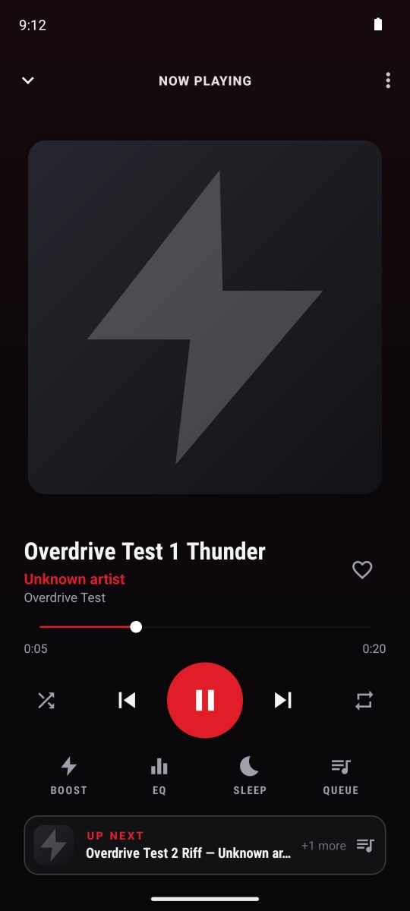
  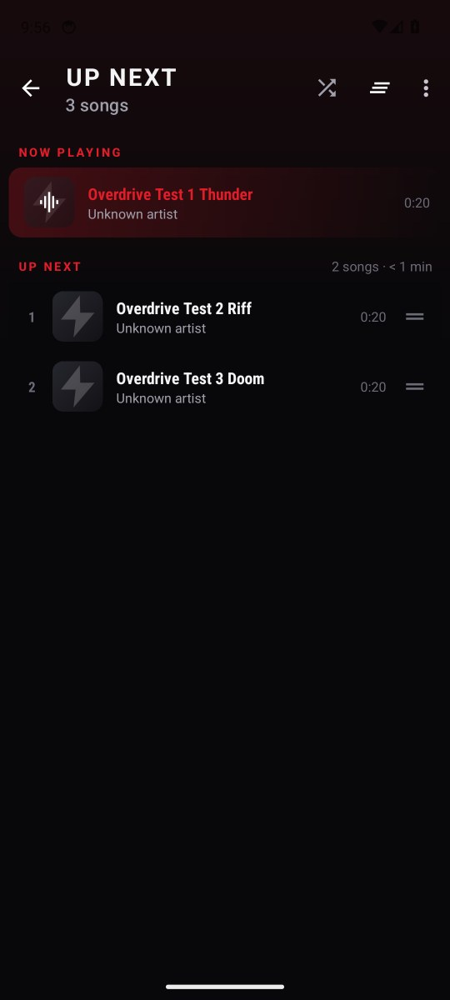
  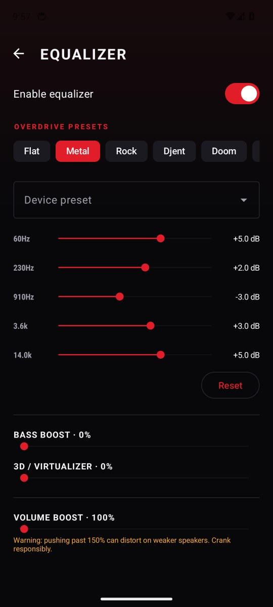
</p>

## Install

**[⬇ Overdrive.apk](Overdrive.apk)** sits in the root of this repository. It's
rebuilt and re-committed by CI on every push, so it's always the latest build.

1. Download `Overdrive.apk` to your phone (open the file on GitHub → *Download raw file*).
2. Open it and allow "Install unknown apps" for your browser / file manager if asked.
3. On first launch, allow access to audio files so Overdrive can find your music.

Or over USB: `adb install -r Overdrive.apk`

> **Updating from the old 1.0 build:** 1.0 was signed with your local
> `overdrive-release.jks`, so Android won't install this build on top of it.
> Uninstall 1.0 first, or set up the signing secrets below so CI signs with
> that same key.

## Features

**Playback**
- Media3 / ExoPlayer engine: gapless playback, background play, lock-screen and
  notification controls, headset buttons, audio focus.
- **Up Next queue**: see exactly what plays next, in real play order (shuffle
  included). Drag to reorder, swipe to remove (with undo), tap to jump,
  clear everything that's coming up.
- "Up next" preview card on Now Playing, plus a queue button on the mini player.
- **Sleep timer**: 5–90 minutes or "end of this track", with a 10-second fade-out.
- **Picks up where you left off**: the last queue and position come back on launch.
- Shuffle and repeat (off / all / one) are remembered.
- Swipe the cover art to skip, double-tap it to play/pause.

**Sound**
- Graphic equalizer using the device's own bands and presets.
- Overdrive presets: **Metal, Rock, Djent, Doom, Vocals up, Flat**, mapped onto
  whatever bands your phone has.
- Bass boost and 3D virtualizer.
- **Volume boost up to 200%** (up to +20 dB through `LoudnessEnhancer`). Only
  affects Overdrive's audio, never other apps. Tap the ⚡ on Now Playing to
  toggle it, long-press it to open the equalizer.

**Library**
- Songs, Albums, Artists, Playlists and Favorites tabs.
- **Playlists**: create, rename and delete them. Add a song, a whole album or the
  current track with "Add to playlist…", or save the queue as a playlist.
  Inside a playlist, long-press and drag to reorder, swipe to remove (with undo).
- Sort songs by title, artist, album, recently added or length.
- Search across songs, albums and artists. Each word has to match, so
  "metallica one" finds the right track.
- Album pages list tracks in order with a big cover, Play and Shuffle buttons;
  artist pages group tracks by album, newest first.
- The track that's playing is highlighted in every list.
- Hide short clips (voice notes, ringtones), rescan any time.

**Look**
- Dark gunmetal UI with condensed bold type and a lightning-bolt logo.
- Now Playing tints itself from the album art.
- Accents: Blood Red, Amped Amber, Steel Blue, Toxic Green.
- Draws edge-to-edge on modern Android.

## Screenshots

These come from the end-to-end test running on an emulator in CI (see below).
The test tracks are generated tones, so they have no cover art.

| Library | Search | Now Playing | Up Next |
| --- | --- | --- | --- |
| 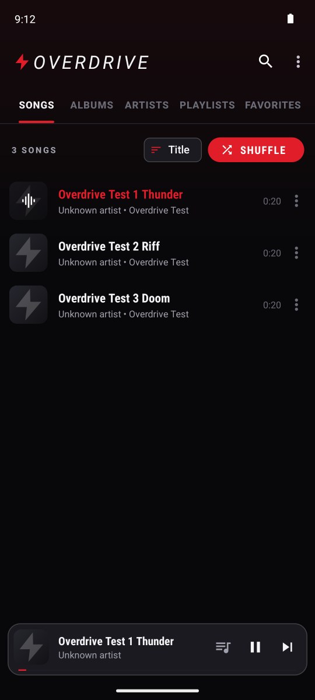 | 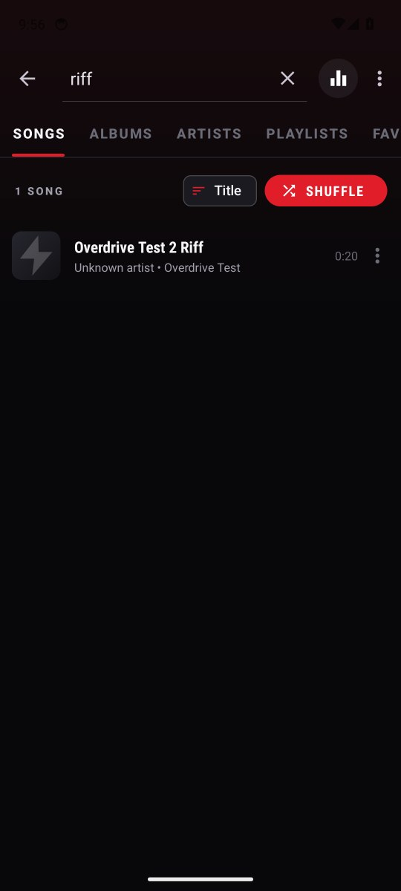 |  |  |

| Sleep timer | Equalizer | Albums | Album |
| --- | --- | --- | --- |
| 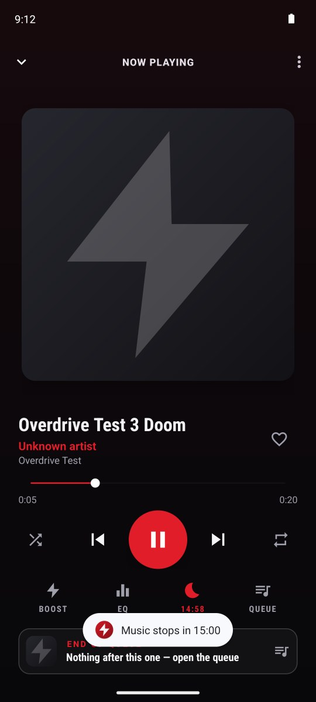 |  | 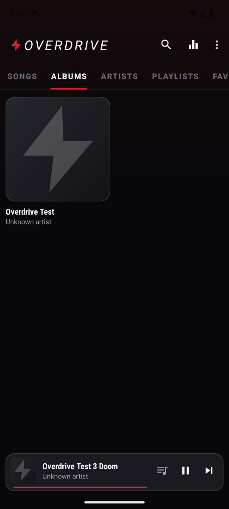 | 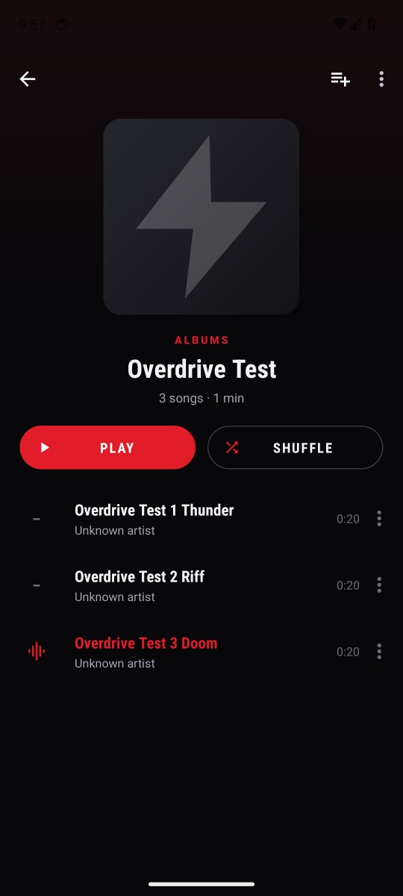 |

| Favorites | Playlists | Playlist |
| --- | --- | --- |
| 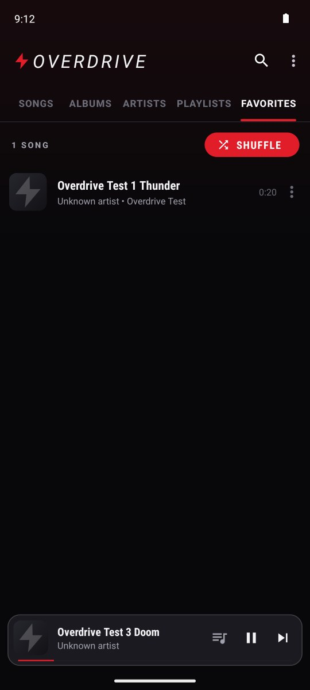 | 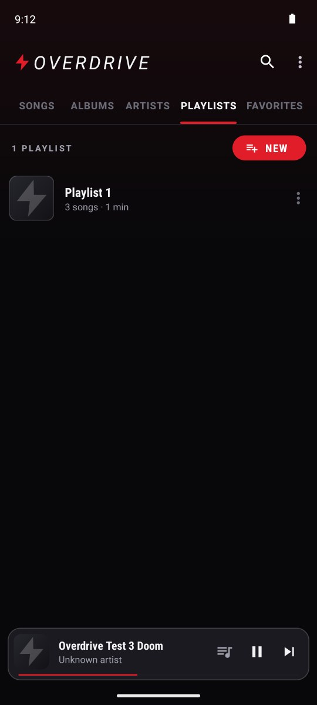 | 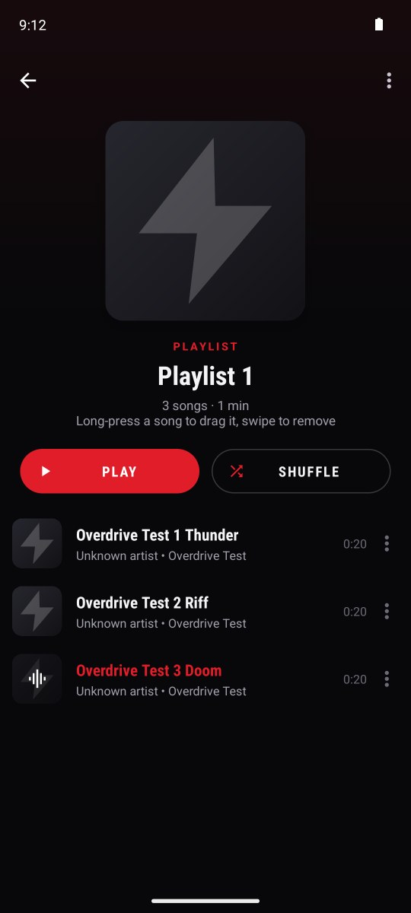 |

## Build from source

Requirements: JDK 17+, Android SDK platform `android-37.2` and build-tools
`37.0.0`. The Gradle wrapper downloads Gradle itself.

```bash
./gradlew :app:testDebugUnitTest   # unit tests
./gradlew :app:assembleDebug       # debug APK
./gradlew :app:assembleRelease     # minified release APK
./gradlew installDebug             # build + install on a connected device
```

### Release signing

Signing keys are **not** stored in this repository. The release build is signed with, in order:

1. `keystore.properties` in the project root (git-ignored). Copy
   `keystore.properties.example` and fill it in.
2. `OVERDRIVE_STORE_FILE`, `OVERDRIVE_STORE_PASSWORD`, `OVERDRIVE_KEY_ALIAS` and
   `OVERDRIVE_KEY_PASSWORD` environment variables.
3. If neither is set, the Android debug key, so the APK still installs.

To have CI sign `Overdrive.apk` with your own key (so every update installs over
the previous one), add these **repository secrets** under
*Settings → Secrets and variables → Actions*:

| Secret | Value |
| --- | --- |
| `OVERDRIVE_KEYSTORE_BASE64` | `base64 -w0 overdrive-release.jks` |
| `OVERDRIVE_STORE_PASSWORD` | keystore password |
| `OVERDRIVE_KEY_ALIAS` | key alias (e.g. `overdrive`) |
| `OVERDRIVE_KEY_PASSWORD` | key password |

Without them, CI signs with a fresh debug key on each run. Each new APK then
has a different signature, so you have to uninstall before installing the
next one.

## CI

GitHub Actions (`.github/workflows/android.yml`) has two jobs:

- **build**: unit tests, lint, debug and R8-minified release APKs. It uploads
  both APKs as build artifacts and commits the release APK as `Overdrive.apk`.
- **ui-tests**: boots an Android 14 emulator and runs `SmokeTest`. The test
  seeds a few generated tracks, plays them and walks every screen: search, Now
  Playing, favorites, volume boost, Up Next (including jumping to a track),
  sleep timer, equalizer presets, albums and playlists. It checks that the
  equalizer and boost are actually attached to the playing audio, then commits
  the screenshots to `docs/screenshots`.

Run the end-to-end test yourself with a device or emulator connected:
`./gradlew :app:connectedDebugAndroidTest`.

## Project layout

```
app/src/main/java/com/overdrive/player/
├── OverdriveApp.kt          # process-wide singletons (settings, audio effects)
├── audio/                   # EQ / bass / virtualizer / loudness + metal EQ curves
├── data/                    # MediaStore scan, Song/Album/Artist, pure library logic
├── player/                  # Media3 service, controller connection, queue, sleep timer
├── prefs/                   # typed SharedPreferences wrapper
├── ui/                      # activities, fragments, adapters, ViewModel
└── util/                    # artwork loader, formatters, theming, insets
```

## Notes on the volume boost

The boost uses Android's `LoudnessEnhancer` on the player's audio session, so
the gain is digital. Past about 150%, badly mastered tracks or small speakers
can clip. That's how every "volume booster" app works. The platform effect is
all there is.
